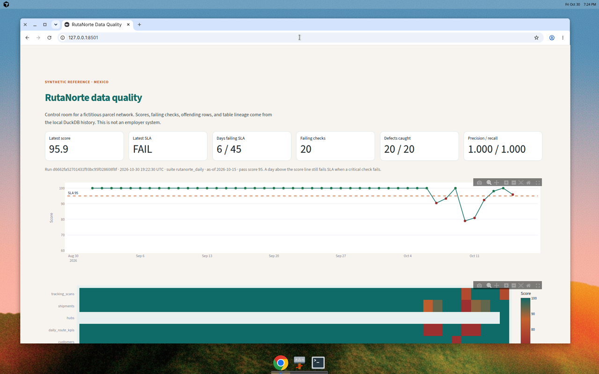
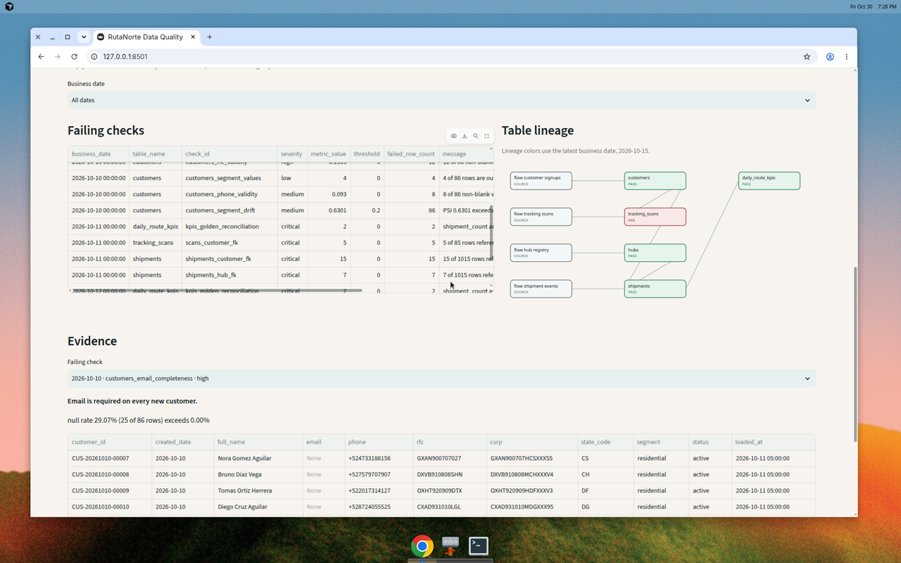
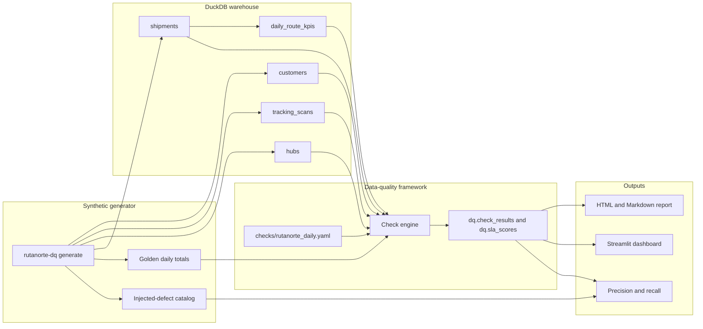
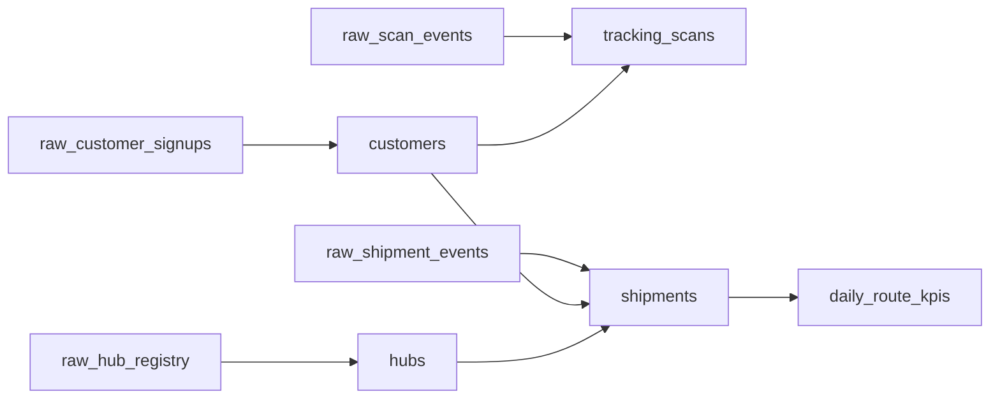

Public site: https://eflores1122.github.io/logistics-data-quality-dashboard/

# RutaNorte data quality

Reference implementation by **Edgar Flores**, Data & AI Engineer (Mexico).

This repository is a portfolio reference. **RutaNorte Paqueteria is a fictitious Mexican parcel and logistics company** created for this project. The warehouse, people, couriers, hubs, shipments, and tracking scans are **synthetic**. Nothing here describes an employer, a client, or a production system.

The project is a local data-quality framework: declarative YAML checks, a DuckDB warehouse with deliberate defects, a severity model with daily SLA scores, a detection report (precision and recall), a CLI export, and a Streamlit control room.

The public site runs those same 39 checks in the browser. DuckDB-WASM loads the seed-42 parquet export under `site/data/` and `site/js/engine.js` scores every business date. Filters, the daily trend, the incident catalog, lineage, and a read-only SQL box all use that run. The screenshots below are the local Streamlit room, not the public site.



Failing checks, lineage for the as-of date, and sample rows with null emails:



## What the reference run found

Seed `42`, business dates **2026-09-01 through 2026-10-15** (45 days). Reproduce with the commands in [How to run](#how-to-run).

| | |
| --- | ---: |
| Hubs | 120 |
| Customers | 3,606 |
| Tracking scans | 3,605 |
| Shipments | 44,220 |
| Published route-KPI days | 45 |
| Clean day, before defects | 1,000 shipments and 1,502,300.00 g |
| Declarative checks | 39 |
| Check results stored | 1,535 |
| Failing checks | 20 |
| Injected defects | 20 |
| Defects caught | 20 |
| Missed | 0 |
| Unexpected failing checks | 0 |
| **Precision** | **1.000** |
| **Recall** | **1.000** |
| Row-level recall | 20 / 20 (1.000) |

A clean day such as 2026-09-20 scores **100.00** and passes the SLA. Six days fail the SLA. 2026-10-13 still **passes** the SLA at **98.10** while one medium-severity drift check fails: the check is caught, and the weighted score stays above 95 with no critical failure. 2026-10-15 scores **95.90**, above the pass line, and **fails** the SLA because tracking-scan freshness is critical (the partition arrived 12.00 hours late).

| Business date | Score | SLA | Failed checks | What was injected |
| --- | ---: | --- | ---: | --- |
| 2026-09-20 | 100.00 | pass | 0 | Nothing. Clean calibration day. |
| 2026-10-07 | 90.48 | fail | 2 | Five cloned shipment ids. Golden count and weight both move. |
| 2026-10-08 | 93.33 | fail | 2 | Every weight rewritten to 1.00–9.50 g. PSI 12.91. Golden weight breaks; the row count still matches. |
| 2026-10-10 | 79.05 | fail | 8 | Null emails, bad RFC / CURP / email / phone, unknown segment, duplicate customer ids. |
| 2026-10-11 | 80.95 | fail | 4 | 15 shipments with an unknown customer, 7 with an unknown hub, 5 scan orphans, golden totals off. |
| 2026-10-12 | 92.38 | fail | 2 | Volume cut from 1,000 to 200 rows (80% below the trailing median). Golden count and weight break. |
| 2026-10-13 | 98.10 | pass | 1 | Channel mix rewritten to 80% counter (baseline counter share is 5%). PSI 3.28. Counts and weights still match the golden file. |
| 2026-10-15 | 95.90 | fail | 1 | Tracking-scan `loaded_at` is 2026-10-16 20:00 against a 08:00 deadline. |

Row-level recall means each catalog entry with a minimum offending-row count was met. Examples: 25 null emails, 12 bad RFCs, 10 duplicate shipment rows, 15 customer orphans, an 800-row gap versus the trailing median.

## Architecture

DuckDB is the local warehouse so the project runs without a cloud account. The check SQL is the same shape you would run in BigQuery Standard SQL: grouped metrics, format validation, and anti-joins for referential integrity. The history tables are the semantic layer a Power BI or Looker model would sit on. Streamlit is the interactive surface so a reviewer can open it locally.



Table lineage inside the warehouse:



The raw nodes are declared lineage only. The generator writes the warehouse tables directly.

## Warehouse

Timestamps are naive warehouse-local times (America/Mexico_City, which does not observe daylight saving). A partition for business date `D` is on time when `max(loaded_at)` is at or before `D` 00:00 plus 32 hours, which is 08:00 the next morning. Clean partitions are stamped at 05:00 the next morning.

| Table | Grain | Role |
| --- | --- | --- |
| `hubs` | One registry row | Branch hub with a persona moral RFC, branch code, and city. Checked once, attributed to the as-of date. |
| `customers` | New recipients by `created_date` | Email, phone, persona fisica RFC, CURP, residential or commercial segment. |
| `tracking_scans` | One scan per signup, plus injected orphans | Barcode, scan event, customer foreign key, freshness. |
| `shipments` | Parcels by `business_date` | Weight in grams, courier, channel, status, customer and hub foreign keys, volume, drift. |
| `daily_route_kpis` | One row per business date | Published totals reconciled to the golden file. Built after defects, so upstream damage shows up here. |

Identifier checks are structural. An RFC or CURP must match the published shape and contain a real calendar date. They are not SAT or RENAPO checksums, and nothing is sent to an external service.

The clean shipment day is an exact quota, repeated across five identical cohorts of 200 rows: 55% home, 25% branch, 15% locker, 5% counter, and six fixed gram weights that sum to 1,502,300.00 g (1,502.30 kg). That keeps volume and drift quiet on healthy days. The volume check uses a **trailing 14-day median**, so the single thin day does not pull later days under the limit. Drift uses the **first 14 business dates as a fixed baseline**, so an incident day cannot leak into the reference and create a follow-on alert.

## Checks, severity, and SLA

Checks live in [`checks/rutanorte_daily.yaml`](checks/rutanorte_daily.yaml).

| Type | What it measures |
| --- | --- |
| `completeness` | Null or blank rate. |
| `uniqueness` | Rows that sit in a duplicate key group. |
| `validity` | Format of non-blank values: `rfc_fisica`, `rfc_moral`, `curp`, `email`, `phone_mx`. |
| `accepted_values` | Membership in a declared list. |
| `referential_integrity` | Child keys missing from the distinct parent key. |
| `freshness` | Hours late versus the partition deadline. |
| `volume_anomaly` | Absolute deviation from the trailing median. |
| `distribution_drift` | Population stability index against the calibration window. Numeric columns use quantile bins fit on that window. |
| `golden_reconciliation` | `count(*)` or `sum(column)` versus `data/golden/shipment_daily_totals.csv`. |

| Severity | Weight | Effect |
| --- | --- | --- |
| critical | 5 | Any failure fails that table and that day, even when the numeric score stays above the line. |
| high | 3 | Included in the weighted score. |
| medium | 2 | Included in the weighted score. |
| low | 1 | Included in the weighted score. |

The daily score is `100 * (weight of passing checks) / (weight of scored checks)`. Skipped checks, used while volume history or the drift calibration window is still filling, stay out of the denominator. The day passes when the score is at least **95** and no critical check failed. The same rule is applied per table. Results are appended to `dq.runs`, `dq.check_results`, and `dq.sla_scores`, so a later run does not erase history. Views `dq.latest_check_results` and `dq.latest_sla_scores` point at the newest run.

A defect is **caught** when its check fails on the injected date and, if the catalog sets `min_failed_rows`, the result counts at least that many offending rows. Precision is caught defects divided by caught defects plus failing checks that are not in the catalog.

## How to run

Python 3.11 or newer.

```bash
python -m venv .venv
source .venv/bin/activate
pip install -e ".[dev,dashboard]"

rutanorte-dq generate
rutanorte-dq run
rutanorte-dq evaluate
rutanorte-dq report --format markdown --output reports/dq_report.md
rutanorte-dq report --format html --output reports/dq_report.html
streamlit run dashboard/app.py

npm ci
npm run build
python -m http.server 4173 --directory site
```

`npm run build` copies DuckDB-WASM into `site/vendor/` and bundles `site/js/app.js`. Open http://127.0.0.1:4173/. Refresh the parquet export, after a generator change, with `python scripts/export_browser_warehouse.py`. `npm run verify` runs the browser engine on that export and compares it with `site/data/reference_results.json`.

`generate` writes:

- `data/warehouse/rutanorte.duckdb` (gitignored; created locally)
- `data/golden/shipment_daily_totals.csv` (clean daily totals, before defects)
- `data/ground_truth/injected_defects.yaml`

`run` appends one suite execution. `evaluate` prints precision, recall, and the daily SLA. `report` writes Markdown or a self-contained HTML file. The dashboard reads the latest run and the defect catalog.

The committed `reports/evaluation.json`, `reports/dq_report.md`, and `reports/dq_report.html` are the output of one real run of those commands. Run ids and timestamps change when you run it again. The scores and the detection counts above are deterministic for seed 42.

## Tests and CI

```bash
ruff check .
ruff format --check .
pytest
```

GitHub Actions (`.github/workflows/ci.yml`) runs that sequence on Python 3.12. The workflow has no secrets and does not call an external warehouse. The reference test rebuilds the 45-day warehouse in a temporary database and locks the detection result plus the incident-day scores.

## Layout

```text
checks/rutanorte_daily.yaml          Declarative suite, lineage, SLA
src/rutanorte_dq/                    Generator, engine, scoring, CLI, reports
dashboard/app.py                     Streamlit control room
site/                                Static control room for GitHub Pages
data/golden/                         Operations golden file
data/ground_truth/                   Labeled defects
reports/                             Sample report from a real run
docs/dashboard.png                   Screenshot of the running dashboard
tests/                               Unit tests and the reference run
```

## License

[MIT](LICENSE). Copyright 2026 Edgar Flores.
